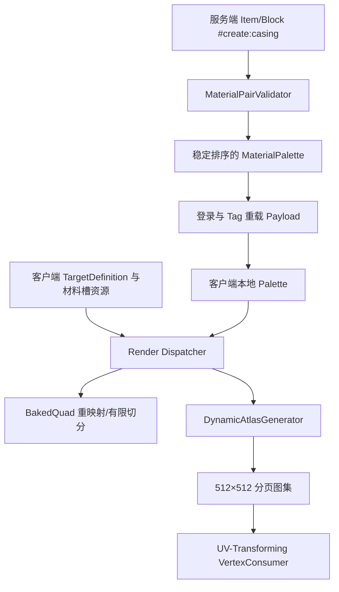

# Casted Materials 设计规格

**日期：** 2026-08-13  
**状态：** 已完成对话设计确认，待规格复核  
**目标平台：** Minecraft 1.21.1、NeoForge 21.1.x、Java 21

## 1. 项目目标

在 `D:\mymod\CastedMaterials` 构建一个可独立加载、也可通过 NeoForge Jar-in-Jar 嵌入多个宿主模组的轻量库模组：

- 模组名称：`Casted Materials`
- Mod ID：`casted_materials`
- Java 包：`com.fluorineuck.castedmaterials`
- 从 Item Tag 与 Block Tag `#create:casing` 发现合法机壳材料；
- 等待注册表和服务端数据包 Tag 完成后建立材料 Palette；
- 把服务端材料 Palette 同步给一个或多个客户端；
- 使用统一 Data Component 保存物品的材料 ID；
- 使用可组合的方块实体状态辅助类保存、同步和暴露方块材料；
- 按目标定义执行像素坐标对应，让同一个物品或方块注册项呈现不同机壳材质；
- 支持每个目标的材料槽覆盖和固定覆盖层；
- 支持普通 JSON 方块/物品模型，以及显式接入 API 的 BER、实体模型和自定义物品渲染器；
- 提供标准 `.bbmodel` + Python 的可视化作者工作流；
- Python、Pillow、`.bbmodel`、预览图和工具测试不进入生产 JAR。

实际铸造机器、配方和加工流程由宿主实现。加工完成后，宿主调用本库 API 写入材料 ID。

## 2. 术语

- **材料（Material）**：同时满足 Item/Block `#create:casing` 配对验证的机壳注册 ID。
- **目标（Target）**：需要根据材料改变外观的逻辑纹理，例如 `create_biotech:spider/body`。
- **源槽（Source Slot）**：从机壳默认方块模型解析出的命名纹理，如 `all`、`side`、`end`、`particle`。
- **映射（Mapping）**：目标像素区域到源槽像素区域的一一对应关系。
- **普通模型路径（Baked Path）**：重映射或有限切分 `BakedQuad`，继续采样原版方块图集中的机壳 Sprite。
- **自定义渲染路径（Dynamic Path）**：生成目标纹理内容，存入 512×512 分页动态图集，并用 `VertexConsumer` 包装器转换 UV。
- **资源代次（Generation）**：一次客户端资源加载或重载所产生的资源版本号。

## 3. 已验证的参考实现

### 3.1 Create 三种基础机壳

本地依赖 `create-1.21.1-6.0.10-280-slim.jar` 中：

| ID | 方块模型 | 槽位 | 纹理性质 |
|---|---|---|---|
| `create:andesite_casing` | `minecraft:block/cube_all` | `all` | 16×16、256 像素全不透明 |
| `create:brass_casing` | `minecraft:block/cube_all` | `all` | 16×16、256 像素全不透明 |
| `create:copper_casing` | `minecraft:block/cube_all` | `all` | 16×16、256 像素全不透明 |

三者的物品模型都继承同 ID 方块模型。Tag 中还包含 `shadow_steel_casing`、`refined_radiance_casing` 和 `railway_casing`；前两者同样使用单一 `all`，铁路机壳使用 `side/end`。

这说明材料像素内部的颜色数量不决定 Quad 数。完整机壳面只需一个 `[0, 0, 16, 16]` 源矩形；Quad 增量只由目标 Face 上存在多少映射分区决定。

### 3.2 Create Biotech 蜘蛛装配台

参考工程 `D:\mymod\Create-Biotech` 中：

- `SpiderAssemblyTableRenderer` 使用 `BlockEntityRenderer + SpiderModel + 64×32` 实体纹理；
- `SpiderAssemblyTableItemRenderer` 使用 Create 的 `CustomRenderedItemModelRenderer`；
- 机械附件使用 Create `PartialModel`；
- 蜘蛛眼睛使用独立发光纹理；
- 普通方块状态模型只代表静态/库存部分。

因此蜘蛛装配台主体必须走自定义渲染路径。其几何 Quad 不被拆分，仅在提交顶点时转换 UV；眼睛和固定机械部件继续使用原纹理。

## 4. 总体架构



主要边界：

1. `material`：Tag 配对验证、Palette、材料状态和公共 API，不依赖客户端类。
2. `network`：Palette 与方块实体材料索引的协议和编解码。
3. `definition`：目标映射 JSON、材料槽覆盖 JSON 和验证。
4. `client.baked`：普通模型加载器、Quad 重映射和切分。
5. `client.dynamic`：异步像素生成、图集分配、渲染线程上传和 Handle。
6. `client.failure`：本地可渲染状态、日志限流与回退。
7. `tools`：标准 `.bbmodel` 初始化、验证、压缩导出和预览；不参与 Gradle 生产资源集。

库不建立 Create Java 依赖，只使用 `create:casing` 的 Tag ID 和 Minecraft/NeoForge 模型资源接口。

## 5. 材料发现与一一对应验证

服务端在注册表冻结且数据包 Tag 完成后，同时读取：

```text
Item Tag  #create:casing
Block Tag #create:casing
```

对每个候选 ID 执行：

```text
item ID == block ID
item instanceof BlockItem
BlockItem#getBlock() == 同 ID block
item ∈ #create:casing
block ∈ #create:casing
```

任一条件失败时：

- 记录包含 ID 和失败条件的错误；
- 跳过该材料；
- 不令数据包重载失败；
- 不阻止玩家进入服务器。

合法 ID 按完整 `namespace:path` 字典序排序。Palette 指纹为有序 UTF-8 ID 列表的 SHA-256。Tag 重载产生相同指纹时不发送重复更新。

## 6. 机壳源槽解析

### 6.1 自动解析

客户端从材料方块默认状态的模型开始，解析模型父链和纹理变量，得到命名槽到 Sprite ID 的映射。普通模型路径使用已进入方块图集的 Sprite；动态路径可从资源管理器读取对应 PNG。

`dominant` 不是真实槽名，而是确定性后备：对解析出的默认模型 Face 按可见面积累计其最终 Sprite，选择累计面积最大者；面积相同时按 Sprite ID 字典序选择。

映射坐标位于目标定义声明的逻辑源网格中，而不是直接假设客户端资源包 PNG 的物理尺寸。普通模型把逻辑坐标归一化后采样 Sprite，因此同宽高比例的高清资源仍可保留其图集细节。动态路径在物理尺寸与逻辑网格一致时逐像素复制；当两者为相同整数倍时使用对应像素块的中心采样并标记 `DEGRADED`；宽高比例不一致或不足以覆盖逻辑网格时回退原纹理。

普通模型继续由原版图集处理动画。动态路径对带 `.mcmeta` 动画的源纹理只使用首帧，标记 `DEGRADED` 并按资源代次记录一次 `ANIMATED_SOURCE_FIRST_FRAME`；第一版不执行逐帧动态图集重生成。

### 6.2 可选材料覆盖

路径：

```text
assets/<namespace>/casted_materials/materials/<path>.json
```

资源 ID `<namespace>:<path>` 对应同 ID 材料。例如：

```json
{
  "schema": 1,
  "slots": {
    "side": "create_biotech:block/explosion_proof_casing_side",
    "end": "create_biotech:block/explosion_proof_casing"
  }
}
```

纹理值使用 Sprite ID 形式，不包含 `textures/` 前缀和 `.png` 后缀。

### 6.3 语义回退

目标请求的槽不存在时依次尝试：

```text
side → all → particle → dominant
end  → all → side → particle → dominant
all  → side → particle → dominant
其他 → all → side → particle → dominant
```

发生回退的组合标记为 `DEGRADED`。所有候选均不可解析时使用目标原始模型或纹理。

## 7. 目标映射格式

路径：

```text
assets/<namespace>/casted_materials/targets/<path>.json
```

资源 ID `<namespace>:<path>` 即目标 ID。坐标均为整数像素；矩形格式统一为 `[x, y, width, height]`。

```json
{
  "schema": 1,
  "size": [64, 32],
  "source_grids": {
    "side": [16, 16],
    "end": [16, 16]
  },
  "regions": [
    {
      "source_slot": "side",
      "source": [0, 0, 16, 16],
      "destination": [0, 0, 16, 16],
      "transform": "identity"
    }
  ],
  "pixels": [
    {
      "source_slot": "end",
      "source": [3, 5],
      "destination": [20, 7]
    }
  ],
  "overlay": "example:casted/spider_overlay",
  "material_overrides": {
    "create_biotech:explosion_proof_casing": {
      "slots": {
        "side": "example:block/special_spider_explosion_proof_side"
      },
      "overlay": "example:casted/spider_explosion_proof_overlay"
    }
  },
  "computed_cost": {
    "max_pieces_per_source_quad": 6,
    "additional_quads": 37
  }
}
```

允许的 `transform`：

```text
identity
rotate_90
rotate_180
rotate_270
mirror_x
mirror_y
```

约束：

- 源矩形与变换后的目标矩形像素尺寸必须一致；
- 每个被引用的源槽都必须在 `source_grids` 中声明逻辑宽高；
- 不进行线性插值或非整数缩放；
- 后声明的区域不能静默覆盖前一区域；重叠必须在导出时失败；
- `pixels` 只保存不能并入矩形的稀疏修正；
- `overlay` 在材料结果上方进行 alpha 合成；
- 一个对象需要多张可变输出纹理时使用多个目标 ID；
- `computed_cost` 只用于诊断，运行时必须从映射和模型重新计算，不能信任资源中的数值。

普通模型的覆盖纹理必须已经由宿主模型或 `assets/minecraft/atlases/blocks.json` 纳入方块图集；缺失时只禁用该覆盖。动态路径直接读取纹理资源，不受此限制。

## 8. 运行时材料状态与公共 API

### 8.1 Data Component

注册：

```text
casted_materials:material
```

值类型为 `ResourceLocation`。使用 Codec 持久化完整 ID，使用 StreamCodec 进行物品同步。任意宿主物品都可以携带该组件。

### 8.2 方块实体组合接口

不强制宿主继承库基类。宿主方块实体实现 `CastedMaterialHolder`，内部组合一个 `CastedMaterialState`：

```java
public interface CastedMaterialHolder {
    CastedMaterialState castedMaterialState();
}
```

`CastedMaterialState` 负责完整 ID 存档、Palette 索引同步、材料变化检测、`ModelData` 更新请求和必要的区块模型重建。它不注册 Tick。

### 8.3 公共写入 API

```java
MaterialSetResult setMaterial(ItemStack stack, ResourceLocation materialId);
MaterialSetResult setMaterial(CastedMaterialHolder holder, ResourceLocation materialId);
Optional<ResourceLocation> getMaterial(ItemStack stack);
Optional<ResourceLocation> getMaterial(CastedMaterialHolder holder);
```

`MaterialSetResult` 明确区分 `CHANGED`、`UNCHANGED`、`UNKNOWN_MATERIAL` 和 `NO_ACTIVE_PALETTE`。非法材料不会清除原值。

### 8.4 普通模型接入

```json
{
  "loader": "casted_materials:casted",
  "base": "example:block/base_machine",
  "target": "example:machine_body"
}
```

- 方块从 `ModelData` 读取材料；
- 物品从 Data Component 读取材料；
- 无材料、非法材料或失败状态返回 `base` 模型。

### 8.5 自定义渲染器接入

```java
CastedTextureHandle handle = CastedMaterialsClient.resolve(
    TARGET_ID,
    materialId,
    ORIGINAL_TEXTURE
);

VertexConsumer consumer = handle.wrap(
    buffer.getBuffer(RenderType.entityCutout(handle.texture()))
);
```

`resolve` 是全函数：永远返回有效 Handle，不返回 `null`，资源错误不会抛进渲染循环。未完成、失败或隔离状态的 Handle 使用 `ORIGINAL_TEXTURE` 和恒等 UV。

## 9. 网络同步

### 9.1 Palette Payload

玩家登录或服务端 Tag 指纹变化时发送：

```text
protocolVersion
paletteFingerprint
ordered ResourceLocation list
```

客户端原子替换 Palette。客户端不得因本地资源缺失删除项或重排索引。

### 9.2 实例材料同步

- 磁盘始终保存完整 `ResourceLocation`；
- 网络更新使用当前 Palette 的 VarInt 索引；
- Palette 更新先于依赖该 Palette 的方块实体增量消息应用；
- 收到未知索引时保留存档值并渲染回退外观，不断开连接。

32 个材料的完整 Palette Payload 预算不超过 4 KiB。材料未变化时不重复发送方块实体更新。

## 10. 普通模型渲染路径

普通模型不生成 PNG，也不触发整包资源重载：

1. 获取原模型 Quad；
2. 把其目标 UV 与映射矩形相交；
3. 完整落在单一区域时只改写 UV；
4. 横跨少量区域时按矩形边界插值位置和 UV，切分为平面子 Quad；
5. 继续使用原版方块图集和原 RenderType；
6. 按 `(资源代次, targetId, materialId, modelKey)` 缓存结果。

Create 三种基础机壳给出的数学最小值是每个原 Quad 1 片。工程默认采用 8 片作为快速路径阈值：

```text
maxPiecesPerSourceQuadFastPath = 8
```

该值不是硬上限：

- `≤ 8`：普通快速路径；
- `> 8`：仍允许，执行完整成本计算和一次性能提示；
- 普通方块每个组合最多新增 2,048 Quad；
- 普通物品每个组合最多新增 8,192 Quad；
- 超过硬上限的组合进入 `FALLBACK_BASE`；
- 原模型自身的 Quad 不计入“新增 Quad”预算；
- 禁止把稀疏像素无界展开为逐像素 Quad。

## 11. 自定义渲染与动态图集

### 11.1 状态机

```text
MISSING → GENERATING → WAITING_UPLOAD → READY
              ↓              ↓
            FAILED       QUARANTINED
```

- 单个后台工作线程执行像素生成；
- 矩形使用行批量复制，只有 `pixels` 逐点处理；
- 图集分配和 GPU 上传只在渲染线程执行；
- 每帧上传预算不超过 2 ms；
- 旧资源代次的任务结果通过 generation token 丢弃。

### 11.2 分页图集

- 页面固定为 512×512 RGBA；
- 按需创建页面；
- 64×32 输出每页可容纳 128 张；
- 默认软预算 4 MiB；
- 默认硬上限 16 MiB；
- 任一输出边长大于 128 像素时记录性能提示；
- 任一输出边长大于 256 像素时拒绝该目标并回退；
- 超过硬内存上限的新组合回退，不破坏已就绪页面；
- 资源重载建立新代图集，原子切换后释放旧 GPU 纹理；
- 不写磁盘缓存。

`CastedTextureHandle` 保存图集页纹理 ID、UV scale/offset、资源代次和回退纹理。包装后的 `VertexConsumer` 对每个顶点执行：

```text
u' = offsetU + u × scaleU
v' = offsetV + v × scaleV
```

蜘蛛装配台等动态模型不切分 Quad，几何顶点数不因材料映射变化。

## 12. 一对多客户端故障隔离

服务端 Palette 是材料身份真值；每个客户端独立维护：

```text
RenderableState[targetId, materialId]
```

状态：

- `READY`：完整动态或普通模型结果；
- `DEGRADED`：使用了槽位语义回退；
- `FALLBACK_BASE`：使用宿主原模型/纹理；
- `QUARANTINED`：本资源代次不再重试该组合。

故障矩阵：

| 故障 | 本客户端处理 |
|---|---|
| 目标映射缺失 | `FALLBACK_BASE` |
| 单个目标 JSON 损坏 | 只禁用该目标文件 |
| `side/end` 缺失 | 语义槽位回退并标记 `DEGRADED` |
| 全部源槽缺失 | 隔离该目标与材料组合 |
| 异步生成异常 | Future 失败，队列继续处理后续任务 |
| 图集达到硬上限 | 新组合回退 |
| GPU 上传失败 | 隔离对应组合；页面级失败时隔离该页面的新 Handle |
| 资源重载竞态 | 丢弃旧 generation token 的结果 |
| 宿主传入非法材料 | 返回回退 Handle 并限流记录错误 |

日志去重键：

```text
资源代次 + 目标 ID + 材料 ID + 错误码
```

客户端渲染失败不得修改服务端状态、改变 Palette 索引、影响其他客户端或导致每帧重复重试。只有网络协议版本或 Jar-in-Jar API 版本不兼容属于连接级错误。

## 13. Blockbench 与 Python 作者工具

### 13.1 工程与打包边界

```text
CastedMaterials/
├─ tools/
│  ├─ casted_bb.py
│  ├─ requirements.txt
│  └─ tests/
├─ examples/
│  └─ spider_body.bbmodel
└─ src/main/resources/
```

Gradle 生产资源集显式排除 `tools/**`、`examples/**`、`**/*.bbmodel` 和预览输出。

### 13.2 标准 `.bbmodel` 约定

只使用标准组、元素、Face UV、Face rotation 和纹理字段：

```text
CM_DEST
└─ body
CM_SOURCE[side]
└─ body
CM_SOURCE[end]
└─ body_end
CM_FIXED
└─ decoration
```

- `CM_DEST` Face UV 是目标纹理坐标；
- `CM_SOURCE[slot]` 中同名元素和同方向 Face 的 UV 是源槽坐标；
- 源纹理的 `uv_width/uv_height` 导出为目标 JSON 的 `source_grids`；
- 配对键为元素稳定名称与 Face 方向；
- 映射副本可在三维视图平移，几何坐标不参与导出；
- Face rotation 和 UV 方向推导旋转/镜像；
- `CM_FIXED` 表示不随材料改变的覆盖部分。

### 13.3 CLI

```powershell
python tools/casted_bb.py init `
  --model spider.json `
  --target create_biotech:spider/body `
  --size 64x32 `
  --slots side,end `
  --output examples/spider_body.bbmodel

python tools/casted_bb.py validate examples/spider_body.bbmodel

python tools/casted_bb.py export examples/spider_body.bbmodel `
  --target-json src/main/resources/assets/create_biotech/casted_materials/targets/spider/body.json `
  --preview build/casted-materials-preview/spider_body.png
```

验证内容：配对完整性、稳定名称唯一性、整数 UV、边界、尺寸、变换、目标写入冲突和空映射。

导出内容：

1. 配对双 UV；
2. 将相邻且变换一致的区域合并为最大矩形；
3. 只把不能合并的点写入 `pixels`；
4. 输出字段顺序和记录排序确定、无时间戳的 JSON；
5. 使用示例机壳纹理生成预览；
6. 再读取导出的 JSON 生成第二张预览并逐像素比较；
7. 计算并写入诊断用 `computed_cost`。

验证失败返回非零退出码，指出组、元素和 Face，不覆盖已有目标 JSON。临时文件只写入 `build/`。

## 14. Jar-in-Jar 与服务端隔离

- 库使用固定 Mod ID `casted_materials` 和语义化版本；
- 宿主的 Jar-in-Jar 元数据声明明确兼容版本范围；
- 多个宿主嵌入兼容版本时由 NeoForge 依赖选择得到一个库实例；
- 不兼容的宿主版本范围必须在加载阶段明确失败，不能同时加载两个 Mod ID 相同的实现；
- 公共初始化路径不引用 `net.minecraft.client`；
- 客户端注册和实现位于客户端专属包，并只在 Dist.CLIENT 事件路径加载；
- 生产 JAR 不内嵌 Create、Pillow 或其他运行时库。

## 15. 测试策略

### 15.1 Java 单元测试

- Item/Block Tag 配对验证与失败跳过；
- Palette 排序、SHA-256 指纹和 VarInt 编解码；
- 源槽父模型解析及语义回退；
- 六种矩形变换和像素对应；
- Quad UV 重映射、平面切分、8 片快速路径与硬预算；
- 图集分页、空间分配、内存预算和缓存命中；
- 异步状态机、资源代次和旧任务丢弃；
- 所有错误路径下 `resolve` 返回有效 Handle。

### 15.2 NeoForge 集成测试

- Data Component 存档与网络同步；
- 方块实体完整 ID 存档、Palette 索引同步和 `ModelData` 更新；
- 玩家登录同步和 Tag 重载同步；
- 非法材料不修改原状态；
- 专用服务器启动不加载客户端类；
- 多宿主 Jar-in-Jar 只产生一个库实例。

### 15.3 一对多故障模拟

相同 Palette 下模拟：

```text
客户端 A：资源完整              → READY
客户端 B：缺 side、有 all       → DEGRADED
客户端 C：目标 JSON 损坏        → FALLBACK_BASE
客户端 D：GPU 上传异常          → QUARANTINED
```

验证 Palette 索引一致、服务端不受影响、错误不逃逸到渲染循环、日志不刷屏、失败任务不阻塞后续生成、资源重载后可在新代重试。

### 15.4 Python 测试

使用 `pytest + Pillow` 验证双 UV 解析、矩形合并、变换、稀疏像素、准确错误、确定性 JSON 和预览逐像素往返一致性。

## 16. 性能与体积预算

| 指标 | 验收门槛 |
|---|---:|
| 32 种机壳 Palette Payload | ≤ 4 KiB |
| 64×32 动态纹理首次 CPU 生成 P95 | ≤ 1 ms |
| 缓存 Handle 解析 P95 | ≤ 0.02 ms |
| 普通 24-Quad 模型首次重映射 P95 | ≤ 0.30 ms |
| 每帧图集上传预算 | ≤ 2 ms |
| 默认动态图集软预算 | 4 MiB |
| 默认动态图集硬上限 | 16 MiB |
| 100 个复杂目标的材质层额外帧耗时 | 目标 ≤ 0.25 ms |
| 生产 JAR 压缩体积 | 目标 ≤ 512 KiB |

预期常规场景 FPS 损失为约 0–1.5%；极端大量复杂 BER 场景的材质层约为 1–6%。最终报告记录基准硬件、场景和实际测量值。帧率不作为不稳定 CI 的硬断言；CPU 生成、缓存和编解码使用可重复微基准。

## 17. 错误处理原则

- 数据包 Tag 中的坏材料：服务端记录并跳过；
- 客户端模型、纹理或目标错误：本地按最小范围降级；
- API 非法输入：返回结构化结果，不静默修改状态；
- 资源任务异常：终止当前组合，不终止工作线程；
- 渲染入口：不返回 `null`，不传播资源异常；
- 重复错误：每个资源代次和错误键只记录一次；
- 协议不兼容：加载或连接阶段明确报告版本范围。

## 18. 非目标

第一版不实现：

- 自动劫持未调用本库 API 的第三方自定义渲染器；
- Shader 注入或渲染管线替换；
- 每 Tick 材质动画；
- 实际铸造机器、配方或加工逻辑；
- 把 Python、Pillow、`.bbmodel`、预览图或开发测试装入生产 JAR；
- 将客户端渲染能力回传并用于修改服务端 Palette。

## 19. 完成条件

实现只有在以下条件同时满足时才算完成：

1. Create 三种基础机壳及 Biotech 三种新增机壳通过一一对应验证和自动槽解析；
2. 服务端数据包修改 `#create:casing` 后，所有连接客户端获得相同有序 Palette；
3. 一个普通方块、一个普通物品和一个蜘蛛装配台式自定义渲染目标成功切换至少三种材料；
4. 物品和方块实体的材料跨保存、重新登录和区块重载保持一致；
5. 一个客户端缺失纹理或目标损坏时，其他客户端继续正常渲染；
6. Python 能生成标准 `.bbmodel`、导出压缩 JSON 并通过预览往返比较；
7. 所有 Java、NeoForge、Python、打包审计和性能基准通过；
8. 生产 JAR 中不存在 `tools/`、`.py`、`.bbmodel`、Pillow 或预览图；
9. 专用服务器能够加载嵌入该库的宿主，而不触发客户端类加载错误。
